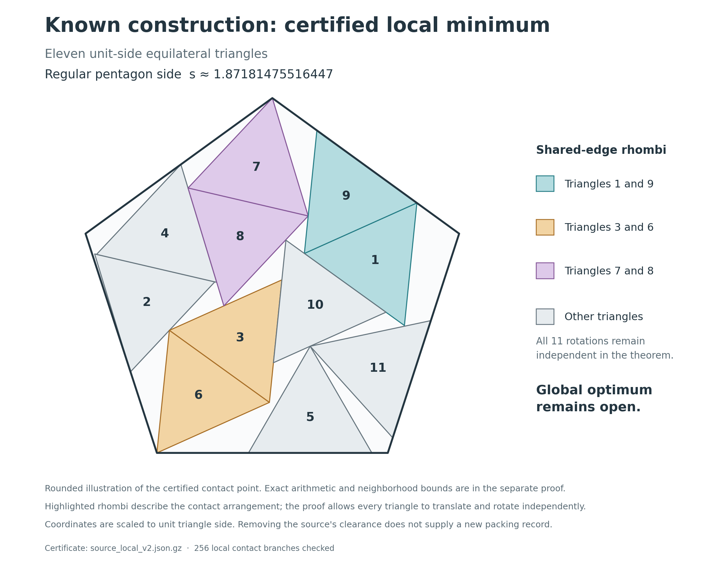

# An exact local-optimality certificate for eleven triangles in a pentagon

[](https://github.com/kevinmneal/eleven-triangle-local-certificate/actions/workflows/verify.yml)

A reproducible, computer-assisted **strict-local-minimum certificate** for a
known packing of eleven congruent equilateral triangles in a regular pentagon.
Every triangle may translate and rotate independently. Verification requires
only Python's standard library.

The construction is due to **Timo Berthold, Dominik Kamp, Gioni Mexi,
Sebastian Pokutta and Imre Pólik**. This project contributes an exact local
certificate for its limiting contact configuration. It makes no claim of a
new packing record, global optimality, or first priority for this local theorem.



The illustrated pentagon has side approximately **1.87181475516447** when
the triangles have side one. The difference from the authors' exported decimal
coordinates removes numerical clearance from the same contact arrangement.

## What is proved

In coordinates where each triangle has circumradius one, there are 34
variables: eleven independent position/angle triples and the pentagon
circumradius. The certificate establishes an exact contact root `p`, proves
that it is a valid packing, and shows that every feasible configuration `q`
in the stated angle charts with

```text
||q - p||_infinity <= 1e-7
```

satisfies

```text
R(q) - R(p) >= 0.00001115 * ||q - p||_infinity.
```

Thus every distinct feasible configuration in that neighborhood requires a
larger pentagon. The neighborhood includes all independent triangle motions
and the container size. It is a bound in these coordinates, not a percentage
of the space of all packings.

The consumer checks the exact root, **all 55 triangle pairs, all 165
vertex/wall inequalities, and all 256 viable nearby contact branches**.
Boundary contact is allowed; overlapping interiors are forbidden.
Read the [theorem and derivation](certificate/source_local_proof.md).

## Reproduce

Python **3.10 or newer**, with no third-party packages:

```sh
git clone https://github.com/kevinmneal/eleven-triangle-local-certificate.git
cd eleven-triangle-local-certificate/certificate
python3 -B -S -O verify_packet.py
python3 -B -S -m unittest -v test_source_local_intervals
```

Require `PASS: frozen packet and exact strict local minimum` from the first
command and all **32 tests** passing from the second. The proof is replayed
from exact data; a saved success message is not sufficient. No optimizer,
internet access or dependency installation is needed for these commands.

The [release validation](validation/receipt.json) records the local replay.
GitHub Actions repeats the checks on Python 3.10 and 3.13. The existing figure
is included; regenerating it is optional and requires the numerical/plotting
packages listed in `certificate/environment_lock.txt`.

## Contribution and limits

A numerical arrangement does not by itself establish exact feasibility or
local optimality. This package connects the published coordinates to an exact
contact configuration and a quantitative local theorem, accounting for changes
in the active contacts while all triangles rotate freely.

The larger discovery and global-proof investigation remains unfinished. A
sustained 35,381-trial shaking/relocation comparison found no improved packing
or established new arrangement at comparable density. Those exploratory
archives are separate from this compact theorem. See the
[research notes and stopping decision](docs/RESEARCH_NOTES.md).

The mathematical and implementation audits are included, but they replay the
same consumer and share arithmetic components. They are **not external peer
review or a wholly independent second proof implementation**. The trust
boundary comprises the stated mathematical argument, rational interval
arithmetic, consumer, Python runtime and supplied source identities. Hashes
establish identity, not mathematical validity. Rounded figures are illustrations.

## Sources and attribution

- [Berthold et al., *Out-of-the-Box Global Optimization for Packing Problems: New Models and Improved Solutions*](https://arxiv.org/abs/2605.04850).
- [Original coordinates at the pinned revision](https://github.com/DominikKamp/Packing/blob/27f71632d8655ae4b6a049410a401976748b94e3/polygon/l5/m3/n11/polygon_n11_m3_l5.txt).
- [Friedman's packing catalogue and construction attribution](https://erich-friedman.github.io/packing/triinpen/).
- [Coordinate identity audit](certificate/sources/source_audit.json).

Rigorous packing certificates and interval methods have substantial prior art,
including [Hales and Kusner's pentagon packing work](https://arxiv.org/abs/1602.07220).
A bounded literature check did not identify a matching public certificate for
this particular arrangement; it does not establish novelty or priority.

Kevin M. Neal directed this research with OpenAI Codex and ChatGPT assistance
for mathematical derivation, code and review. See the
[contribution disclosure](ACKNOWLEDGEMENTS.md) and
[packet provenance](PROVENANCE.md).

Code is MIT-licensed; original documentation, figures and certificate data
are CC BY 4.0. Prior constructions and external material retain their own
attribution and rights. See [reuse terms](LICENSE.md) and [citation](CITATION.cff).
