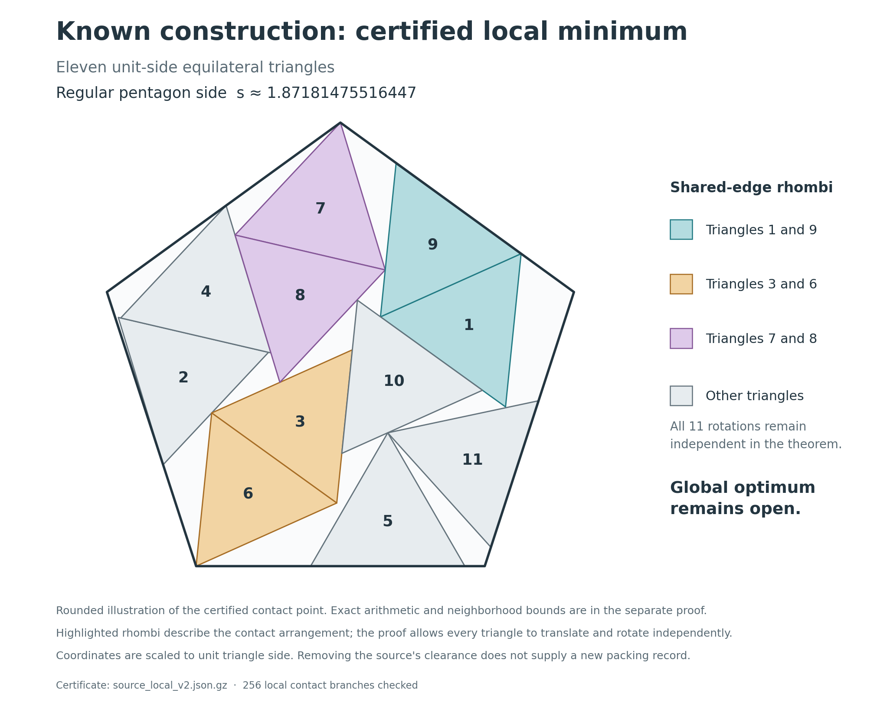

# A certified strict local minimum at the known source construction

9 October 2026. **A separate exact-arithmetic consumer verifies an exact contact packing near the published source and proves that it is a strict local minimum.** This is a local theorem. It does not establish the globally smallest pentagon, exclude a disconnected better arrangement, or supply a new packing record.

The certificate describes an implicit exact point, not the positive-clearance decimal input used by the search. Removing that input's clearance accounts for the numerical side change. The source construction and its original attribution remain unchanged.



The illustration uses rounded coordinates scaled to unit triangle side; the exact theorem is below. Its three highlighted rhombi describe the contact arrangement, while the proof permits every triangle to move independently. Source coordinates are preserved from [Dominik Kamp's Packing repository](https://github.com/DominikKamp/Packing/blob/27f71632d8655ae4b6a049410a401976748b94e3/polygon/l5/m3/n11/polygon_n11_m3_l5.txt), with the pinned byte identity in [the source audit](sources/source_audit.json). This attribution does not assert priority for a local-optimality proof.

## Statement

Use triangle circumradius one and clockwise angles from +y, with the regular pentagon centered and oriented as in the original source. Let the 34 coordinates be the eleven independent triples `(x_i,y_i,theta_i)` followed by pentagon circumradius `R`. All triangle rotations remain independent; none is pinned in the local theorem.

There is a unique zero `p` of the certificate's 34 contact equations in the closed coordinate box of radius `1e-24` around its exact decimal center. The verified enclosure of its unit-side container side is

```
1.871814755164470141324697303905737649597897564590010074843743
<= s(p) <=
1.871814755164470141324698661337632196603720100538979125264435
```

This exact point is a feasible packing. For every feasible labeled configuration `q` satisfying `||q-p||_infinity <= 1e-7` in these coordinates and the same angle charts,

```
R(q) - R(p) >= 0.00001115 * ||q-p||_infinity.
```

The verified coefficient is greater than `0.00001115964160`; `0.00001115` is a conservative downward rounding. Hence every distinct feasible configuration in this neighborhood has a strictly larger radius. The neighborhood includes all translations, all eleven independent rotations and the container radius. Label permutations and equivalent triangle angle charts do not remove any sufficiently nearby physical motion.

The current [certificate](certificates/source_local_v2.json.gz) and [full consumer verdict](verification/source_local_radius_1e_minus_7_verdict.json) give exact values, all 256 branch bounds and the geometric incidence derivation. The earlier radius-1e-9 candidate and its verdict remain preserved separately.

## 1. Existence of the exact contact point

The approximate source was used only to propose a 34-row square equation system, an exact decimal box center `x0`, and a rational inverse candidate `B`. A deterministic high-precision equality reconstruction supplied those proposals; it did not minimize the packing objective or introduce a new arrangement.

The consumer independently evaluates the analytic equations `F` and their Jacobian with outward-rounded rational intervals. For the entire box `X`, it proves

```
||I - B J_F(X)||_infinity < 3.73e-15
x0 - B F(x0) + (I - B J_F(X))(X-x0) lies strictly inside X.
```

Thus `T(x)=x-BF(x)` is a contraction mapping of the closed box into itself. The contraction theorem supplies a unique fixed point. Since `B J_F` is invertible, so is the square matrix `B`, and the fixed point satisfies `F(p)=0`. The verified image radius is below `3.73e-39`, within the declared `1e-24` box. No small floating residual is treated as an exact zero.

## 2. Exact closure and packing feasibility

There are 36 rows in the first contact branch, while the root system uses 34. The two omitted rows are not accepted merely because their high-precision residuals are tiny. The consumer derives their exact zero values from incidences implied by the selected equations.

Each triangle edge is the line through its two opposite vertices. The selected contact equations put further vertices on those lines or on a pentagon wall. The closure algorithm uses three elementary rules:

1. Two certified distinct points determine a line.
2. Two certified nonparallel lines determine a point.
3. Two equal-length triangle edges on the same line, with a shared endpoint and certified common direction, have the same other endpoint.

Distinctness is established from disjoint coordinate enclosures or from the distinct vertices of one unit equilateral triangle. Nonparallelism is established by a determinant interval excluding zero. Common direction is established by a strictly positive interval dot product. The equal edge length is exactly `sqrt(3)` in the chosen units. The third rule is necessary: collinearity and one shared endpoint alone would not determine the other endpoint.

Sixteen such steps derive 55 exact pair-feature incidences and twelve exact wall incidences, including the omitted equations and the support rows needed by alternative contact branches. All remaining inequalities used for root feasibility have strictly positive rational interval lower bounds. The consumer checks all **55 pairs** and all **165 vertex/wall inequalities**. Thirty-eight pairs are strictly separated; seventeen are contact pairs. Boundary contact is allowed throughout.

## 3. Exhaustive nearby branch coverage

For a pair of convex triangles, nonoverlap is equivalent to the existence of an outward owner-edge separator among the six edges of the two triangles. Each edge branch requires all three vertices of the other triangle to lie beyond that edge: an OR across edge choices and an AND across support vertices.

The consumer enumerates the six edge choices for every contact pair itself. It accepts exact-zero rows only through the incidence derivation. Other support features of a viable branch must have strict positive enclosures at the root. It proves each excluded edge has a strictly negative feature throughout the entire enlarged coordinate box covering the `1e-7` neighborhood of the exact root. All **77 excluded contact edges** are bounded this way.

The seventeen contact pairs leave exactly **256 combinations** of viable edge branches. Every combination is checked once, in a reconstructed deterministic order; missing, extra or differently indexed witnesses fail. Each branch contains all twelve active wall inequalities and its selected exact-zero pair support inequalities. No contact edge is frozen across all configurations, and no tied support row is discarded.

The thirty-eight noncontact pairs need not remain separated throughout the neighborhood for the lower-bound argument: a nearby feasible configuration already satisfies their nonoverlap conditions. Ignoring these extra necessary constraints can only enlarge the configurations covered by the branchwise obstruction.

## 4. Quantitative local growth, allowing residuals

For one branch, write its active smooth inequalities as `g(q)>=0`, with `g(p)=0`, and let `C=J_g(p)`. The input supplies positive rational weights `lambda` and a rational approximate left inverse `L`; neither is trusted without checking.

The consumer proves, with induced infinity matrix norms,

```
delta = ||I-LC||_infinity < 1
M >= ||L||_infinity / (1-delta)
epsilon >= ||C^T lambda - e_R||_1
kappa <= min(lambda)/M - epsilon, with kappa > 0.
```

All bounds hold for the exact root anywhere in its certified box. In particular, `||d||_infinity <= M ||Cd||_infinity`. The stress residual uses the **1-norm**, as required when `d` is measured in infinity norm. The weights need not solve an equilibrium equation exactly.

Put `t=||q-p||_infinity`. Direct differentiation of an owner-edge/vertex feature gives a second directional derivative bounded by

```
(||c_other-c_owner||_1 + 12) * t^2.
```

The three terms are the rotating-normal term, bounded by center distance; the translation/owner-rotation cross term, bounded by `8t^2`; and the relative-angle term, bounded by `4t^2`. Wall second derivatives are at most `t^2`. Taylor's integral remainder therefore gives `g(q)=Cd+r`, with every `|r_i| <= h*t^2`. The consumer recomputes the center-distance bound on the whole enlarged box and obtains `h < 8.442215`.

For feasible `q`, `g(q)` is componentwise nonnegative, so

```
lambda^T g(q) >= min(lambda) * ||g(q)||_infinity
              >= min(lambda) * (t/M - h*t^2).
```

Using the stress residual and the remainder bound yields

```
R(q)-R(p) >= kappa*t - h*(min(lambda)+sum(lambda))*t^2.
```

At `t<=1e-7`, every one of the 256 branches has a strictly positive resulting linear coefficient. The smallest verified coefficient exceeds `0.00001115964160`, proving the stated theorem. This argument allows all independent rotations and does not depend on an optimizer's success flag, an LP feasibility tolerance, or an assumed exact floating stress.

## Consumer and review boundary

Run the separate standard-library consumer from this directory:

```sh
python3 -B -S -O check_source_local.py certificates/source_local_v2.json.gz
```

It imports only standard-library code and the unchanged interval arithmetic from `hardened_checker.py`. The arithmetic uses an outward-rounded integer grid of `1e-60`, a rational Machin enclosure of pi, and Taylor enclosures for sine and cosine. Acceptance uses explicit integer/rational comparisons; it does not depend on Python assertions, SciPy, NumPy, finite differences or the supplied numerical diagnostic reports.

The consumer reconstructs root feasibility, incidence closure, branch coverage, Hessian bounds and all witness inequalities. Numerical reconstruction, LP weights and pseudoinverses remain untrusted discovery inputs. [Kernel audit](research/source_local_kernel_audit.md) and [independent mathematical audit](research/source_local_proof_audit.md) record review scope and any qualifications. Regression and mutation checks are in `test_source_local_intervals.py`.

The main unresolved question remains **global**: whether an arrangement outside this certified neighborhood fits a smaller pentagon. This certificate is useful local proof infrastructure and a precise description of the known source template; it does not close that global question. No publication or priority claim is made.
